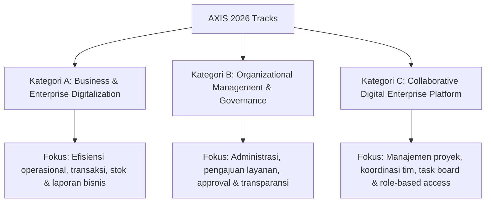
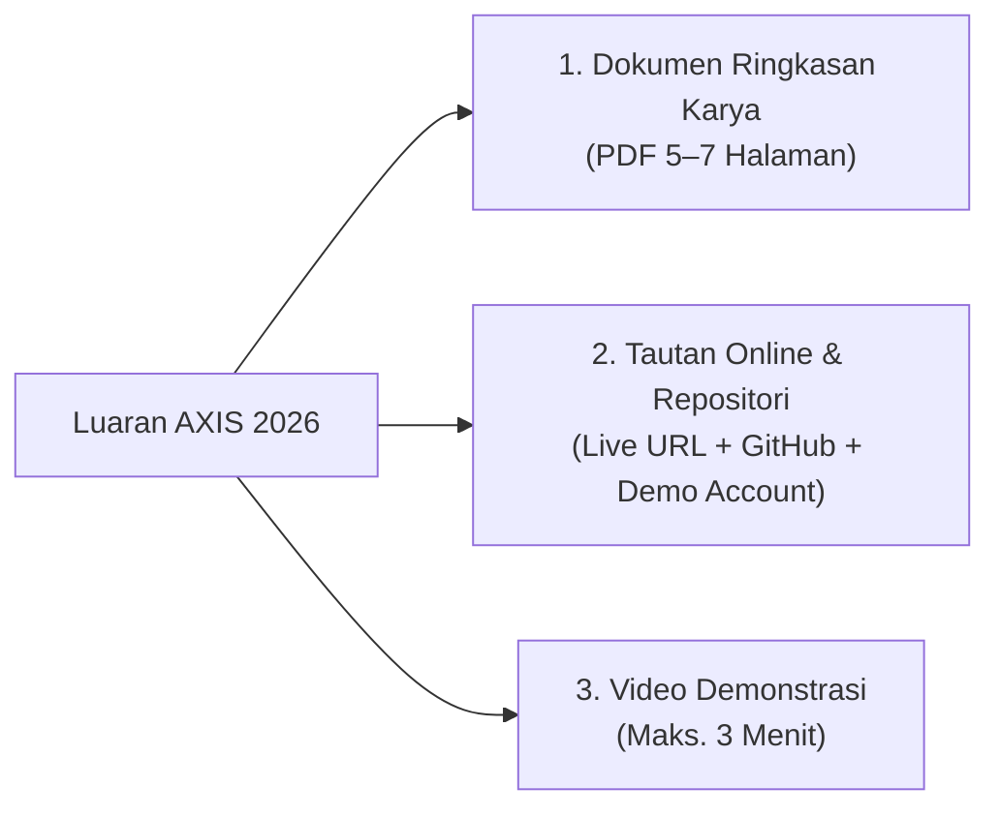
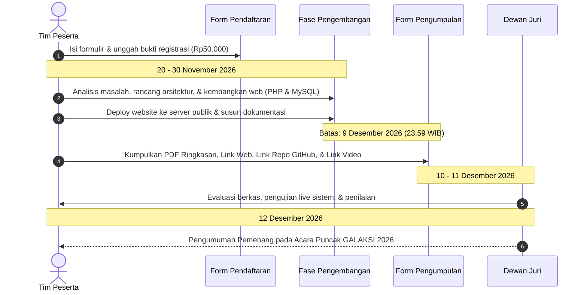
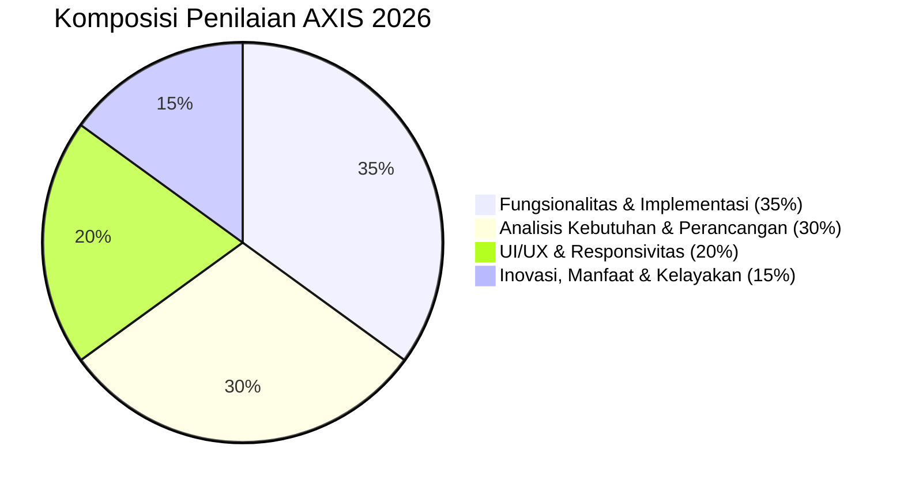

# 📘 GUIDEBOOK PESERTA
## AXIS 2026 (Application eXcellence in Information Systems)
### *National Web Development Competition | GALAKSI 2026*
> *"Where Innovation Meets Web Technology"*

---

### 🎯 TEMA KOMPETISI
> **"Empowering Organizations & Digital Enterprises through Resilient Web Architectures"**

---

## 📑 DAFTAR ISI

1. [Profil dan Tujuan Kompetisi](#1-profil-dan-tujuan-kompetisi)
   - 1.1 Latar Belakang
   - 1.2 Tujuan Kompetisi
   - 1.3 Identitas Kompetisi
   - 1.4 Tema Utama
2. [Sasaran Peserta dan Ketentuan Tim](#2-sasaran-peserta-dan-ketentuan-tim)
   - 2.1 Persyaratan Peserta
   - 2.2 Komposisi dan Ketentuan Tim
3. [Tema dan Kategori Studi Kasus](#3-tema-dan-kategori-studi-kasus)
   - 3.1 Kategori A: Business & Enterprise Digitalization
   - 3.2 Kategori B: Organizational Management & Governance
   - 3.3 Kategori C: Collaborative Digital Enterprise Platform
   - 3.4 Prinsip Pemilihan dan Pengembangan
4. [Ketentuan Teknis Pengembangan Website](#4-ketentuan-teknis-pengembangan-website)
   - 4.1 Teknologi yang Wajib Digunakan
   - 4.2 Standar Minimum Aplikasi
   - 4.3 Hal yang Perlu Diperhatikan Peserta
5. [Luaran dan Berkas yang Wajib Dikumpulkan](#5-luaran-dan-berkas-yang-wajib-dikumpulkan)
   - 5.1 Dokumen Ringkasan Karya (PDF 5–7 Halaman)
   - 5.2 Tautan Aplikasi dan Repositori GitHub
   - 5.3 Video Demonstrasi Aplikasi (Maks. 3 Menit)
6. [Pendaftaran dan Mekanisme Pengumpulan](#6-pendaftaran-dan-mekanisme-pengumpulan)
   - 6.1 Informasi Administratif
   - 6.2 Alur Pendaftaran dan Pengumpulan
   - 6.3 Tahapan dan Jadwal Kompetisi
7. [Sistem Penilaian](#7-sistem-penilaian)
   - 7.1 Fungsionalitas dan Implementasi Website (35%)
   - 7.2 Analisis Kebutuhan dan Perancangan Sistem (30%)
   - 7.3 UI/UX dan Responsivitas Website (20%)
   - 7.4 Inovasi, Manfaat, dan Kelayakan Solusi (15%)
8. [Etika dan Ketentuan Umum](#8-etika-dan-ketentuan-umum)
   - 8.1 Orisinalitas dan Hak Kekayaan Intelektual
   - 8.2 Kesesuaian Studi Kasus
   - 8.3 Kesiapan Akses Penjurian
   - 8.4 Ketentuan yang Memerlukan Keputusan Panitia
9. [Penutup](#9-penutup)
- [Lampiran A: Rancangan Struktur Dokumen Ringkasan](#lampiran-a-rancangan-struktur-dokumen-ringkasan)
- [Lampiran B: Checklist Kesiapan Pengumpulan](#lampiran-b-checklist-kesiapan-pengumpulan)
- [Lampiran C: Format Lembar Informasi Tim dan Karya](#lampiran-c-format-lembar-informasi-tim-dan-karya)

---

## PENGANTAR

**AXIS 2026** merupakan cabang kompetisi pengembangan aplikasi web tingkat nasional dalam rangkaian **GALAKSI 2026**. Kompetisi ini dirancang untuk mengintegrasikan kemampuan analisis kebutuhan, perancangan sistem, implementasi teknologi web yang tangguh (*resilient*), serta penciptaan solusi digital yang aplikatif dan relevan bagi organisasi maupun dunia usaha.

Panduan ini disusun untuk memberikan acuan resmi dan komprehensif bagi seluruh calon peserta terkait tata tertib, ketentuan teknis, kriteria evaluasi, mekanisme pendaftaran, jadwal pelaksanaan, hingga standar luaran karya yang wajib dikumpulkan.

---

## 1. Profil dan Tujuan Kompetisi

### 1.1 Latar Belakang
Perkembangan teknologi digital telah menjadikan aplikasi berbasis web sebagai sarana krusial dalam mendukung kelangsungan aktivitas organisasi bisnis, institusi pendidikan, pemerintahan, hingga pelayanan publik. Peran website kini telah berevolusi dari sekadar media penyampai informasi statis menjadi platform dinamis terintegrasi yang mengeksekusi proses bisnis dan transaksi kritis.

Kebutuhan tersebut menuntut hadirnya talenta pengembang aplikasi web muda yang tidak hanya menguasai sintaks *coding*, namun juga memiliki kemampuan analitis dalam memahami persoalan nyata pengguna, merancang arsitektur sistem yang modular dan andal, serta mengimplementasikan antarmuka yang ramah pengguna. **AXIS 2026** hadir sebagai wadah kompetisi prestisius berskala nasional yang menitikberatkan pada tiga pilar utama: **analisis kebutuhan yang tajam**, **perancangan sistem yang matang**, dan **kualitas implementasi aplikasi web yang nyata serta berfungsi penuh**.

### 1.2 Tujuan Kompetisi
1. **Mengembangkan Kreativitas & Keterampilan**: Menempa kemampuan teknis mahasiswa dalam rekayasa aplikasi web modern.
2. **Mendorong Inovasi Aplikatif**: Memicu lahirnya gagasan dan solusi digital yang berdampak nyata bagi persoalan organisasi dan industri.
3. **Mengasah Kompetensi Komprehensif**: Melatih integrasi antara analisis kebutuhan bisnis, desain basis data, arsitektur perangkat lunak, dan keamanan sistem.
4. **Meningkatkan Standar Kualitas Perangkat Lunak**: Mendorong terciptanya aplikasi web yang fungsional, andal, responsif lintas perangkat, dan nyaman digunakan (*usable*).
5. **Membangun Jejaring Nasional**: Menjadi ajang kolaborasi, unjuk bakat, dan pertukaran gagasan positif bagi talenta muda sistem informasi dan informatika se-Indonesia.

### 1.3 Identitas Kompetisi

| Parameter | Deskripsi |
| :--- | :--- |
| **Nama Kompetisi** | AXIS 2026 |
| **Kepanjangan** | Application eXcellence in Information Systems |
| **Bidang Lomba** | National Web Development Competition |
| **Tagline** | *"Where Innovation Meets Web Technology"* |
| **Kegiatan Induk** | GALAKSI 2026 |
| **Skala Kompetisi** | Nasional (Perguruan Tinggi se-Indonesia) |
| **Ruang Lingkup** | Pengembangan aplikasi web fungsional berbasis studi kasus nyata |

### 1.4 Tema Utama
> **"Empowering Organizations & Digital Enterprises through Resilient Web Architectures"**

Tema ini menekankan pentingnya pengembangan solusi web yang inovatif, stabil, aman, dan berkelanjutan untuk mengakselerasi transformasi digital organisasi serta meningkatkan produktivitas entitas bisnis. Setiap karya wajib memperlihatkan keselarasan logis yang runtut antara **masalah pengguna**, **perancangan arsitektur sistem**, dan **fitur aplikasi yang berhasil diimplementasikan**.

---

## 2. Sasaran Peserta dan Ketentuan Tim

### 2.1 Persyaratan Peserta
- Peserta merupakan mahasiswa aktif program Sarjana (S1) dari Perguruan Tinggi Negeri (PTN) maupun Perguruan Tinggi Swasta (PTS) di seluruh Indonesia.
- Kompetisi bersifat terbuka tanpa batasan program studi atau jurusan.
- Peserta wajib membuktikan status keaktifan melalui Kartu Tanda Mahasiswa (KTM) atau surat keterangan mahasiswa aktif saat pendaftaran.

### 2.2 Komposisi dan Ketentuan Tim
1. **Jumlah Anggota**: Setiap tim beranggotakan **2 hingga 4 orang mahasiswa aktif S1**. Salah satu anggota bertindak sebagai Ketua Tim.
2. **Asal Perguruan Tinggi**: Seluruh anggota dalam satu tim wajib berasal dari **perguruan tinggi yang sama**. Diperbolehkan kolaborasi lintas program studi dan angkatan.
3. **Batas Pendaftaran**: Setiap tim hanya diperbolehkan mendaftarkan **1 (satu) karya aplikasi web**.
4. **Kepesertaan Tunggal**: Setiap mahasiswa hanya diperkenankan tergabung dalam **1 (satu) tim**. Rangkap keanggotaan tidak diperbolehkan.
5. **Orisinalitas Mutlak**: Karya yang diajukan wajib merupakan karya orisinal tim, belum pernah memenangkan kompetisi sejenis sebelumnya, dan tidak melanggar hak cipta/HKI pihak manapun.
6. **Kepatuhan Aturan**: Seluruh anggota tim wajib mematuhi seluruh mekanisme, batas waktu, dan kode etik yang ditetapkan panitia.

---

## 3. Tema dan Kategori Studi Kasus

Setiap tim **wajib memilih 1 (satu) dari 3 (tiga) kategori studi kasus** di bawah ini. Peserta didorong untuk mengembangkan ide, studi kasus spesifik, alur kerja, dan fitur inovatif selama tetap berakar pada kategori yang dipilih:



### 3.1 Kategori A: Business & Enterprise Digitalization
- **Fokus Utama**: Digitalisasi proses bisnis, operasional harian, dan tata kelola transaksi enterprise/UKM. Mengedepankan efisiensi kerja, otomatisasi pencatatan data, serta akurasi pelaporan.
- **Tantangan Studi Kasus**:
  > *Kembangkan aplikasi web manajemen operasional bisnis yang mengintegrasikan pengelolaan katalog produk/layanan, pencatatan transaksi, dan pergerakan persediaan (inventory) untuk meningkatkan efektivitas kerja serta meminimalisasi kesalahan manual.*

### 3.2 Kategori B: Organizational Management & Governance
- **Fokus Utama**: Tata kelola organisasi modern, administrasi terpusat, manajemen sumber daya, serta penyediaan layanan internal/eksternal yang transparan dan akuntabel.
- **Tantangan Studi Kasus**:
  > *Kembangkan aplikasi web manajemen administrasi organisasi yang mencakup alur pengajuan layanan/surat/izin, mekanisme persetujuan berjenjang (approval workflow), dan pemantauan status proses secara *real-time* dan transparan.*

### 3.3 Kategori C: Collaborative Digital Enterprise Platform
- **Fokus Utama**: Platform interaksi digital antar-anggota tim, pembagian peran kerja, distribusi penugasan, dan kolaborasi penyelesaian target bersama dalam suatu ekosistem kerja digital.
- **Tantangan Studi Kasus**:
  > *Kembangkan aplikasi web manajemen proyek dan kolaborasi tim yang dilengkapi dengan fitur pembagian tugas (task assignment), pelacakan progres pekerjaan (progress tracking), dan diferensiasi hak akses berdasarkan peran pengguna.*

### 3.4 Prinsip Pemilihan dan Pengembangan Solusi
Dalam mengembangkan karya, peserta diharapkan memegang 5 prinsip utama berikut:
1. **Target Masalah Nyata**: Definisikan persona pengguna dan *pain points* spesifik yang ingin dipecahkan.
2. **Relevansi Solusi**: Pastikan batasan masalah dan fitur yang dibangun berada dalam koridor kategori yang dipilih.
3. **Keterkaitan Logis (Traceability)**: Bangun benang merah yang runtut dari analisis masalah pengguna $\rightarrow$ perancangan arsitektur sistem $\rightarrow$ fitur yang diwujudkan.
4. **Keandalan & Kegunaan**: Utamakan kestabilan fungsi, integritas data, serta kenyamanan pengalaman pengguna (*usability*).
5. **Proporsionalitas Fitur**: Hadirkan fitur tambahan yang bernilai tambah (*value-added features*) tanpa mengorbankan stabilitas fungsionalitas inti dari studi kasus.

---

## 4. Ketentuan Teknis Pengembangan Website

### 4.1 Teknologi yang Wajib Digunakan
Untuk memastikan kesetaraan evaluasi teknis, standar teknologi berikut **wajib dipatuhi**:

| Layer | Teknologi yang Diwajibkan / Diizinkan | Keterangan |
| :--- | :--- | :--- |
| **Backend (Wajib)** | **PHP** (Native atau Framework) | Diperbolehkan menggunakan Native PHP atau Framework seperti **Laravel**, **CodeIgniter**, **Symfony**, dll. |
| **Database (Wajib)** | **MySQL** / MariaDB | Relasional, mendukung transaksi data, integritas referensial, dan validasi input. |
| **Frontend** | HTML5, CSS3, JavaScript | Bebas menggunakan framework/library antarmuka seperti **Tailwind CSS**, **Bootstrap**, jQuery, Vue/React (sebagai client layer), dll. |

> [!NOTE]
> Pemilihan framework modern (misal Laravel vs Native PHP) **tidak secara otomatis memberikan nilai tambah**. Dewan juri menilai kualitas arsitektur, kerapian struktur kode, keandalan fungsionalitas, keamanan dasar, serta kesesuaian implementasi dengan kebutuhan sistem.

### 4.2 Standar Minimum Aplikasi
Setiap karya yang dikumpulkan wajib memenuhi standar minimum berikut:
1. **Aksesibilitas Online Publik**: Aplikasi telah dideploy pada server/hosting publik yang dapat diakses oleh dewan juri tanpa kendala selama masa penjurian.
2. **Fungsional Penuh**: Seluruh fitur utama berfungsi secara nyata (bukan sekadar tampilan dummy atau *hardcoded UI*).
3. **Interaktif & Dinamis**: Aplikasi bukan sekadar *landing page* statis, melainkan memiliki interaksi data timbal balik dengan pengguna.
4. **Desain Responsif**: Tampilan antarmuka beradaptasi dengan baik di perangkat *desktop*, *tablet*, maupun *smartphone*.
5. **Integrasi Basis Data MySQL**: Menyimpan, membaca, mengubah, dan menghapus data pada MySQL dengan validasi input yang baik (*server-side* & *client-side*).
6. **Implementasi Operasi CRUD**: Menyediakan alur *Create, Read, Update, Delete* yang sesuai dengan proses bisnis studi kasus.
7. **Autentikasi & Multi-Role Authorization**: Memiliki sistem login/logout dengan **minimal 2 (dua) tingkat peran pengguna (roles)** dengan otorisasi menu dan hak akses yang berbeda (contoh: *Admin* dan *User / Pegawai*).
8. **Keamanan Dasar & Penanganan Eror**: Memperhatikan sanitasi input dasar (pencegahan SQL Injection, XSS), perlindungan rute (*route protection*), serta tampilan pesan kesalahan yang informatif.
9. **Kepatuhan Lisensi (HKI)**: Semua pustaka, modul, gambar, atau ikon pihak ketiga mematuhi lisensi terbuka (*open source / royalty-free*).

### 4.3 Checklist Praktis Peserta

```
[ ] Fungsi Utama     : Alur bisnis inti dapat diuji dari awal (input) hingga akhir (output/laporan).
[ ] Integritas Data  : Data CRUD tersimpan konsisten dan terbaca akurat di tabel MySQL.
[ ] Hak Akses (RBAC) : Pengujian login dengan 2 role menampilkan menu & pembatasan aksi yang berbeda.
[ ] Pengalaman UX    : Form memiliki validasi jelas, tombol responsif, dan layout navigasi intuitif.
[ ] Ketersediaan URL : URL hosting dapat diakses kapan saja selama penjurian tanpa down.
[ ] Dokumentasi Code : Repositori GitHub memiliki file README.md lengkap dan panduan instalasi lokal.
```

---

## 5. Luaran dan Berkas yang Wajib Dikumpulkan

Peserta wajib menyiapkan dan mengunggah **3 (tiga) komponen luaran utama**:



### 5.1 Dokumen Ringkasan Karya
- **Format**: File tunggal berformat **PDF**.
- **Panjang Halaman**: **5 sampai 7 halaman** (tidak termasuk cover lembar pengesahan jika ada).
- **Struktur Isi Dokumen**:
  1. Identitas Tim dan Judul Karya Aplikasi.
  2. Latar Belakang dan Identifikasi Permasalahan Pengguna.
  3. Tujuan, Manfaat, dan Sasaran Target Pengguna.
  4. Analisis Kebutuhan Sistem dan Spesifikasi Fitur Utama.
  5. Perancangan Proses Bisnis (Flowchart / Activity Diagram / BPMN).
  6. Arsitektur Sistem dan Desain Basis Data (ERD / Entity Relationship Diagram & Kamus Data ringkas).
  7. Spesifikasi Teknologi yang Digunakan dan Tangkapan Layar (*Screenshot*) Antarmuka Utama Website.
*(Rincian panduan struktur dokumen dapat dilihat pada [Lampiran A](#lampiran-a-rancangan-struktur-dokumen-ringkasan)).*

### 5.2 Tautan Aplikasi dan Repositori GitHub
1. **Tautan Live Deployment**: URL publik website yang aktif dan siap diuji (misal via VPS, cPanel, Railway, Heroku, dsb.).
2. **Tautan Repositori GitHub**: URL repositori GitHub yang dapat diakses publik oleh dewan juri.
3. **Dokumentasi `README.md` pada Repositori**: Wajib memuat:
   - Deskripsi singkat aplikasi & nama tim.
   - Daftar teknologi dan versi yang digunakan (PHP version, MySQL version, UI frameworks).
   - Fitur-fitur utama sistem.
   - Petunjuk langkah instalasi dan konfigurasi lokal (*prerequisites, env setup, migration / import sql*).
   - Skema basis data ringkas / file dump SQL pendukung.
4. **Akun Demonstrasi (Demo Credentials)**: Wajib menyediakan minimal 2 pasang *username/email* dan *password* untuk masing-masing role yang berbeda dalam form pengumpulan dan `README.md`.

### 5.3 Video Demonstrasi Aplikasi
- **Durasi**: **Maksimal 3 (tiga) menit**.
- **Ketentuan Konten**: Video harus mendemonstrasikan aplikasi web yang berjalan secara nyata (bukan animasi mock-up semata).
- **Muatan Video**:
  1. Pengenalan singkat permasalahan yang diangkat.
  2. Penjelasan solusi digital yang dikembangkan.
  3. Demonstrasi langsung penggunaan fitur-fitur utama.
  4. Simulasi alur proses bisnis dari sudut pandang peran pengguna.
  5. Penjelasan manfaat dan nilai tambah solusi bagi pengguna akhir.
- **Format Pengunggahan**: Diunggah ke platform video (YouTube / Google Drive) dengan akses diatur ke *Public* atau *Unlisted* (dapat dilihat oleh siapapun yang memiliki tautan).

---

## 6. Pendaftaran dan Mekanisme Pengumpulan

### 6.1 Informasi Administratif

| Keterangan | Informasi Resmi |
| :--- | :--- |
| **Biaya Pendaftaran** | **Rp50.000,-** per tim |
| **Tautan Pendaftaran** | [https://forms.gle/5QWPv4pqVaXKXz3i7](https://forms.gle/5QWPv4pqVaXKXz3i7) |
| **Tautan Pengumpulan Karya** | [https://forms.gle/z6LmuzqaYRqVUZaNA](https://forms.gle/z6LmuzqaYRqVUZaNA) |
| **Narahubung Resmi (WhatsApp)** | [+62 851-8107-9659](https://wa.me/6285181079659) |
| **Format Rekening Pembayaran** | Tercantum pada formulir pendaftaran resmi |

### 6.2 Alur Partisipasi Peserta



### 6.3 Tahapan dan Jadwal Kompetisi

| Tahapan Kegiatan | Tanggal Pelaksanaan | Keterangan |
| :--- | :--- | :--- |
| **Publikasi Lomba** | Jumat, 20 November 2026 | Pembukaan sosialisasi resmi AXIS 2026 |
| **Periode Pendaftaran** | **20 – 30 November 2026** | Pengisian form & pembayaran registrasi |
| **Pengembangan & Pengumpulan Karya** | **20 November – 9 Desember 2026** | Batas submit: **9 Desember 2026 pukul 23.59 WIB** |
| **Proses Penjurian** | 10 – 11 Desember 2026 | Evaluasi sistem, kode, dokumen, & video |
| **Acara Puncak & Pengumuman Hasil** | **Sabtu, 12 Desember 2026** | Pengumuman pemenang pada puncak GALAKSI 2026 |

---

## 7. Sistem Penilaian

Penilaian karya dilakukan secara objektif dan independen oleh dewan juri ahli dengan total bobot **100%**, yang terbagi ke dalam 4 aspek penilaian:



### 7.1 Fungsionalitas dan Implementasi Website (Bobot: 35%)
1. **Kelengkapan Fitur**: Keberhasilan eksekusi seluruh alur fungsional utama yang dijanjikan dalam rancangan sistem.
2. **Manajemen Data & CRUD**: Kerapian dan ketepatan operasi tambah, baca, perbarui, dan hapus data di basis data MySQL.
3. **Autentikasi & Otorisasi**: Ketegasan kontrol akses pengguna berdasarkan peran (*role-based access control*), pencegahan bypass hak akses.
4. **Stabilitas & Error Handling**: Ketahanan sistem terhadap masukan tak terduga (*input sanitization*), bebas *crash / unhandled exception*, dan kejelasan umpan balik kesalahan (*error feedback*).
5. **Kualitas Teknis Kode**: Struktur penulisan kode yang rapi, modular, dan mematuhi konvensi arsitektur yang baik.

### 7.2 Analisis Kebutuhan dan Perancangan Sistem (Bobot: 30%)
1. **Ketepatan Identifikasi Masalah**: Kejelasan fenomena masalah nyata yang mendasari perlunya aplikasi dibangun.
2. **Kejelasan Sasaran & Persona Pengguna**: Ketepatan perumusan target pengguna dan skenario kebutuhan mereka.
3. **Kesesuaian Solusi Teknis**: Kecocokan solusi aplikasi web yang dirancang dengan akar persoalan yang diangkat.
4. **Ketepatan Perancangan Proses & Arsitektur**: Kualitas diagram alur proses bisnis (Flowchart/BPMN) serta diagram arsitektur sistem dan relasi basis data (ERD).
5. **Konsistensi Rancang-Bangun**: Kesinambungan yang solid antara dokumen analisis, diagram perancangan, dan hasil implementasi perangkat lunak.

### 7.3 UI/UX dan Responsivitas Website (Bobot: 20%)
1. **Kemudahan Penggunaan (Usability)**: Antarmuka intuitif, memudahkan pengguna menyelesaikan tugas tanpa kebingungan.
2. **Konsistensi Desain**: Keselarasan tipografi, tata warna, penataan tombol (*components hierarchy*), dan *design system*.
3. **Kejelasan Struktur Navigasi**: Alur perpindahan halaman yang logis, *breadcrumb*, dan menu yang terorganisir.
4. **Pengalaman Pengguna (UX)**: Kenyamanan alur interaksi, keberadaan umpan balik visual (*loading state, toast notification, modal dialog*).
5. **Responsivitas Perangkat**: Tampilan tetap proporsional dan berfungsi prima saat diakses di berbagai ukuran layar (*desktop, tablet, mobile*).

### 7.4 Inovasi, Manfaat, dan Kelayakan Solusi (Bobot: 15%)
1. **Kreativitas & Kebaruan**: Keunikan ide pendekatan atau fitur yang membedakan karya dari aplikasi konvensional sejenis.
2. **Relevansi Solusi**: Tingkat signifikansi kegunaan solusi terhadap penyelesaian masalah nyata di dunia organisasi/bisnis.
3. **Potensi Penerapan Nyata**: Kelayakan sistem untuk diadopsi atau diimplementasikan secara konkret di lingkungan kerja operasional.
4. **Dampak Efisiensi**: Potensi aplikasi dalam memangkas waktu kerja, biaya operasional, atau mereduksi kesalahan pencatatan.
5. **Potensi Keberlanjutan**: Kemudahan sistem untuk dikembangkan lebih lanjut di masa mendatang (*maintainability & scalability*).

---

## 8. Etika dan Ketentuan Umum

### 8.1 Orisinalitas dan Hak Kekayaan Intelektual
- Karya yang diajukan harus merupakan hasil kreasi dan rekayasa orisinal tim peserta.
- Penggunaan *boilerplate*, pustaka sumber terbuka (*open-source libraries*), framework CSS/JS, dan aset berlisensi gratis diperbolehkan dengan tetap menghormati ketentuan lisensi yang berlaku.
- Dilarang keras melakukan plagiarisme atau mengumpulkan karya milik orang lain/proyek komersial yang sudah ada sebelumnya.

### 8.2 Kesesuaian Kategori Studi Kasus
- Setiap tim wajib menjaga agar solusi yang dibangun konsisten dengan salah satu kategori yang dipilih (Kategori A, B, atau C).
- Penambahan modul atau inovasi fitur pelengkap sangat diapresiasi selama tidak mengaburkan tujuan utama studi kasus.

### 8.3 Kesiapan Akses Penjurian
- Peserta bertanggung jawab penuh memastikan tautan *deployment*, repositori GitHub, dan video demonstrasi dapat diakses secara lancar oleh dewan juri selama periode penjurian.
- Apabila aplikasi memerlukan kredensial login, akun pengujian dengan hak akses relevan wajib dicantumkan secara jelas. Segala kendala akses akibat *server down* atau *private access* di luar tanggung jawab panitia.

### 8.4 Hak dan Keputusan Panitia
- Panitia berhak melakukan verifikasi administratif atas status keaktifan mahasiswa dan data karya yang dikumpulkan.
- Panitia dan dewan juri berhak mendiskualifikasi tim yang terbukti melakukan pemalsuan identitas, kecurangan teknis, maupun pelanggaran etika kompetisi.
- **Keputusan dewan juri bersifat mutlak, independen, dan tidak dapat diganggu gugat oleh pihak manapun.**

---

## 9. Penutup

**AXIS 2026** diselenggarakan untuk menjadi ajang pembuktian kompetensi rekayasa perangkat lunak bagi mahasiswa di seluruh nusantara. Melalui integrasi antara analisis sistem yang mendalam dan penguasaan teknologi web yang tangguh, kompetisi ini diharapkan melahirkan inovator-inovator digital yang siap berkontribusi bagi transformasi organisasi dan dunia industri di era modern.

Tunjukkan karya terbaik tim Anda! Sambut masa depan teknologi melalui semangat:
> **"Where Innovation Meets Web Technology"**

---

<br/>

## LAMPIRAN A: Rancangan Struktur Dokumen Ringkasan
*(Panduan Isi Dokumen PDF 5 sampai 7 Halaman)*

Setiap tim menyusun dokumen PDF ringkasan karya dengan batasan **5 s.d. 7 halaman** menggunakan sistematika berikut:

- **Halaman 1: Identitas Tim & Ringkasan Eksekutif**
  - Judul Karya Aplikasi Web, Logo Tim/Aplikasi.
  - Identitas Tim (Nama Tim, Asal Universitas, Nama Ketua & Anggota, NIM/Program Studi).
  - Kategori Studi Kasus yang Dipilih (A / B / C).
  - Ringkasan Eksekutif (*Executive Summary*): 1–2 paragraf ringkas mengenai problem yang diangkat, solusi yang dibangun, dan nilai unggul aplikasi.
- **Halaman 2: Latar Belakang, Identifikasi Masalah & Target Pengguna**
  - Analisis konteks permasalahan yang dihadapi organisasi/bisnis.
  - Rumusan masalah spesifik dan kebutuhan target pengguna (*user persona*).
  - Tujuan dan manfaat implementasi sistem.
- **Halaman 3: Proses Bisnis & Alur Kerja Sistem**
  - Penjelasan proses bisnis sebelum vs. sesudah digitalisasi.
  - Diagram Alur Kerja (Flowchart / Business Process Model / Activity Diagram).
- **Halaman 4: Arsitektur Sistem & Perancangan Basis Data**
  - Diagram Arsitektur Perangkat Lunak (Hubungan Client-Server-Database).
  - Desain Basis Data: Diagram Relasi Entitas (*Entity Relationship Diagram / ERD*) lengkap dengan atribut kunci dan relasi antar-tabel MySQL.
- **Halaman 5: Fitur Utama & Pembagian Peran Pengguna (RBAC)**
  - Matriks fitur sistem berdasarkan peran pengguna (*role-based permissions*).
  - Deskripsi fungsional fitur-fitur kunci yang mendukung studi kasus.
- **Halaman 6: Spesifikasi Teknologi & Dokumentasi Antarmuka (UI Mockup / Screenshot)**
  - Rincian *tech-stack* (versi PHP, modul MySQL, UI framework/library).
  - Tangkapan layar antarmuka utama pada tampilan Desktop dan Mobile disertai keterangan fungsi.
- **Halaman 7: Kesimpulan, Nilai Keberlanjutan & Tautan Akses**
  - Kesimpulan dampak solusi terhadap efisiensi organisasi.
  - Rencana pengembangan lebih lanjut (*future work & roadmap*).
  - Cantuman tautan ringkas: URL Live Web, URL GitHub, dan URL Video Demo.

---

## LAMPIRAN B: Checklist Kesiapan Pengumpulan

Gunakan daftar periksa berikut sebelum mengunggah berkas ke formulir pengumpulan resmi:

- [ ] **Kelayakan Tim**: Terdiri dari 2–4 mahasiswa aktif jenjang S1 dari universitas yang sama.
- [ ] **Kepesertaan Tunggal**: Seluruh anggota hanya terdaftar dalam satu tim di AXIS 2026.
- [ ] **Kategori Studi Kasus**: Aplikasi sesuai dengan salah satu track (A, B, atau C).
- [ ] **Stack Backend**: Dibangun menggunakan bahasa pemrograman PHP (Native atau Framework).
- [ ] **Stack Database**: Terintegrasi penuh dengan basis data MySQL.
- [ ] **Fungsionalitas Inti**: Fitur utama berfungsi normal tanpa kendala proses bisnis.
- [ ] **Operasi CRUD**: Mekanisme Create, Read, Update, Delete data berjalan lancar dan tervalidasi.
- [ ] **Autentikasi Multi-Peran**: Sistem otorisasi minimal memiliki 2 role pengguna dengan pembatasan hak akses yang jelas.
- [ ] **Responsivitas Tampilan**: Layout antarmuka tertata rapi di resolusi desktop dan layar mobile.
- [ ] **Hosting / Live URL**: Website telah dideploy secara online dan dapat diakses publik tanpa hambatan login server/jaringan.
- [ ] **Repositori GitHub Publik**: Repositori dapat dibuka dan diakses oleh publik/juri.
- [ ] **README.md Repositori**: Memuat pengenalan, daftar fitur, kebutuhan PHP/MySQL, petunjuk instalasi, dan konfigurasi database.
- [ ] **Kredensial Demo**: Akun demonstrasi untuk setiap peran telah disediakan di formulir dan file README.
- [ ] **Dokumen Ringkasan Karya**: Telah diekspor ke format PDF dengan ketebalan tepat 5 sampai 7 halaman.
- [ ] **Video Demonstrasi**: Durasi maksimal 3 menit, menampilkan aplikasi live yang beroperasi, dan link video dapat diputar publik/unlisted.
- [ ] **Pemeriksaan Hak Akses Berkas**: Seluruh tautan (URL web, GitHub, video, PDF) telah diuji coba melalui *Incognito Window* browser.

---

## LAMPIRAN C: Format Lembar Informasi Tim dan Karya

Salin dan lengkapi format informasi berikut ke dalam berkas pengumpulan atau bagian awal formulir:

```text
1.  Nama Tim                     : [Isi Nama Tim]
2.  Asal Perguruan Tinggi        : [Isi Nama Universitas / Institut / Sekolah Tinggi]
3.  Nama Ketua Tim               : [Nama Lengkap Ketua] (NIM: __________)
4.  Nama Anggota 2               : [Nama Lengkap Anggota 2] (NIM: __________)
5.  Nama Anggota 3 (jika ada)    : [Nama Lengkap Anggota 3] (NIM: __________)
6.  Nama Anggota 4 (jika ada)    : [Nama Lengkap Anggota 4] (NIM: __________)
7.  Program Studi                : [Program Studi Anggota Tim]
8.  Judul Karya                  : [Judul Aplikasi Web yang Dikembangkan]
9.  Kategori Studi Kasus         : [Kategori A / B / C]
10. Tautan Aplikasi (Live URL)   : https://...
11. Tautan Repositori GitHub     : https://github.com/...
12. Tautan Video Demonstrasi     : https://... (YouTube / Google Drive)
13. Akun Demonstrasi             : 
    - Role 1 (Admin/Superuser)   : Email/Username = [...] | Password = [...]
    - Role 2 (Staff/User)        : Email/Username = [...] | Password = [...]
14. Ringkasan Masalah & Solusi   :
    [Deskripsikan dalam 2-3 kalimat masalah yang diselesaikan dan solusi unik dari website]
15. Fitur-Fitur Utama            :
    - [Fitur 1]
    - [Fitur 2]
    - [Fitur 3]
    - [dst.]
```

---
*Panitia Pelaksana AXIS 2026 | National Web Development Competition | GALAKSI 2026*
