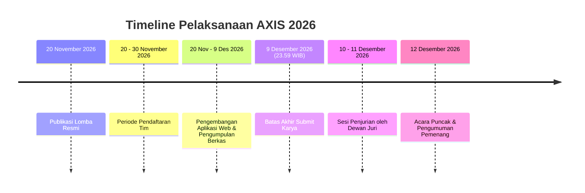

<div align="center">

# 🌐 AXIS 2026
### **Application eXcellence in Information Systems**
#### *National Web Development Competition — GALAKSI 2026*

<p align="center">
  <em>"Where Innovation Meets Web Technology"</em>
</p>

[](https://forms.gle/5QWPv4pqVaXKXz3i7)
[](https://github.com/axis-competition/axis-2026)
[](https://github.com/axis-competition/axis-2026)
[](https://github.com/axis-competition/axis-2026)

---

### 🏆 Tema Kompetisi
> **"Empowering Organizations & Digital Enterprises through Resilient Web Architectures"**

</div>

---

## 📌 Navigasi Cepat
- 🌐 **[Portal Resmi Kompetisi (Website)](https://axis-competition.github.io/axis-2026/)**
- 📖 **[Guidebook Peserta Format Web (guidebook.html)](./guidebook.html)**
- 📘 **[Guidebook Peserta Format Markdown (GUIDEBOOK.md)](./GUIDEBOOK.md)**
- 📦 **[Template Repositori Pengumpulan (submission-template)](https://github.com/axis-competition/submission-template)**
- 📝 **[Form Pendaftaran Resmi](https://forms.gle/5QWPv4pqVaXKXz3i7)** *(Dibuka 20 – 30 November 2026)*
- 📤 **[Form Pengumpulan Karya](https://forms.gle/z6LmuzqaYRqVUZaNA)** *(Batas: 9 Desember 2026 pukul 23.59 WIB)*
- 💬 **Narahubung Resmi (WhatsApp)**: **[+62 851-8107-9659](https://wa.me/6285181079659)**

---

## 💡 Sekilas Tentang AXIS 2026

**AXIS 2026** merupakan cabang kompetisi pengembangan aplikasi web berskala nasional dalam rangkaian kegiatan **GALAKSI 2026**. Kompetisi ini menguji dan mengapresiasi kemampuan mahasiswa dalam:
1. **Analisis Kebutuhan**: Memahami persoalan riil organisasi dan merumuskan solusi komputasional yang tepat sasaran.
2. **Perancangan Arsitektur**: Merancang struktur data relasional (MySQL), alur proses bisnis (BPMN/Flowchart), dan modularitas sistem.
3. **Kualitas Rekayasa Web**: Mengimplementasikan antarmuka interaktif yang responsif, manajemen data terintegrasi, dan keamanan dasar menggunakan ekosistem **PHP & MySQL**.

---

## 👥 Ketentuan Tim Peserta
- Mahasiswa aktif program **Sarjana (S1)** dari PTN/PTS di seluruh Indonesia (semua program studi).
- Setiap tim terdiri dari **2 sampai 4 orang** dari perguruan tinggi yang sama (boleh lintas prodi & angkatan).
- Setiap peserta hanya boleh tergabung dalam **1 tim**, dan setiap tim hanya mengajukan **1 karya**.
- Biaya pendaftaran: **Rp50.000,-** per tim.

---

## 🎯 Kategori Studi Kasus
Peserta wajib memilih salah satu dari tiga lintasan studi kasus berikut:

| Kategori | Fokus Utama | Contoh Tantangan Studi Kasus |
| :--- | :--- | :--- |
| **Kategori A**<br>*(Business & Enterprise Digitalization)* | Digitalisasi proses bisnis, operasional terpadu, dan manajemen data komersial. | Web manajemen operasional terintegrasi: katalog produk, pencatatan transaksi, dan pergerakan persediaan/stok untuk mereduksi kesalahan pencatatan. |
| **Kategori B**<br>*(Organizational Management & Governance)* | Tata kelola organisasi, administrasi terpusat, pengajuan layanan publik/internal, dan transparansi. | Web administrasi organisasi: portal pengajuan izin/surat/layanan, sistem persetujuan berjenjang (*approval workflow*), dan pelacakan status transparan. |
| **Kategori C**<br>*(Collaborative Digital Enterprise Platform)* | Kolaborasi tim, manajemen aktivitas terdistribusi, dan pengaturan hak akses peran. | Web manajemen proyek & kolaborasi: pembagian tugas (*task assignment*), pemantauan progres (*progress tracking*), dan kontrol akses berbasis peran (*RBAC*). |

---

## ⚙️ Ketentuan Teknis & Standar Minimum

```
Stack Wajib:
├── Backend  : PHP (Native atau Framework: Laravel, CodeIgniter, Symfony, dll)
├── Database : MySQL / MariaDB (Relasional, CRUD terstruktur, data validation)
└── Frontend : HTML5, CSS3, JavaScript (Bebas: Tailwind, Bootstrap, Vue, React, dll)
```

### Standar Minimum Aplikasi:
- 🌐 **Live Deployment**: Website dihosting publik dan aktif selama periode penjurian (10–11 Desember 2026).
- ⚙️ **Fungsional & Interaktif**: Fitur utama berjalan nyata dari hulu ke hilir (bukan sekadar prototipe statis).
- 📱 **Responsif**: Tampilan antarmuka nyaman digunakan pada resolusi *desktop* maupun *mobile*.
- 🗄️ **Integrasi MySQL & CRUD**: Mengimplementasikan manipulasi data Create, Read, Update, Delete secara konsisten.
- 🔐 **Autentikasi & Multi-Role**: Memiliki sistem login dengan minimal **2 peran pengguna** (misal: *Admin* dan *User*) dengan batasan hak akses menu yang berbeda.
- 🛡️ **Keamanan Dasar**: Dilengkapi validasi input (*sanitization*), pencegahan SQL injection/XSS dasar, dan penanganan error yang baik.

---

## 📦 Berkas Luaran yang Wajib Dikumpulkan

Saat pengumpulan karya, tim wajib menyerahkan:

1. **📄 Dokumen Ringkasan Karya (PDF 5–7 Halaman)**:
   - Sesuai dengan [Lampiran A Guidebook](./GUIDEBOOK.md#lampiran-a-rancangan-struktur-dokumen-ringkasan). Memuat identitas tim, latar belakang masalah, analisis kebutuhan, proses bisnis, arsitektur & ERD basis data, tech stack, dan tangkapan layar UI.
2. **🌐 Tautan Live Deployment & Repositori GitHub**:
   - URL website aktif yang dapat diuji juri secara langsung.
   - URL repositori GitHub dengan file `README.md` berstandar resmi (lihat [Template README Peserta](./templates/TEMPLATE_README_PESERTA.md)).
   - Akun uji coba (*demo credentials*) minimal 2 role.
3. **🎥 Video Demonstrasi Aplikasi (Maksimal 3 Menit)**:
   - Video memperlihatkan simulasi fitur nyata di website yang berjalan.
   - Menjelaskan masalah $\rightarrow$ solusi $\rightarrow$ demo fungsi utama $\rightarrow$ manfaat bagi target pengguna.
   - Tautan video dapat diakses publik / unlisted (YouTube / Google Drive).

---

## 📅 Jadwal Penting (Timeline)



| Tahapan | Jadwal | Keterangan |
| :--- | :--- | :--- |
| **Publikasi Lomba** | 20 November 2026 | Pembukaan sosialisasi kompetisi |
| **Pendaftaran Peserta** | **20 – 30 November 2026** | Mengisi [Form Pendaftaran](https://forms.gle/5QWPv4pqVaXKXz3i7) |
| **Pengembangan & Submit** | **20 Nov – 9 Des 2026** | Batas pengumpulan: **9 Desember 2026, 23.59 WIB** |
| **Penjurian** | 10 – 11 Desember 2026 | Penilaian menyeluruh oleh tim juri |
| **Pengumuman Juara** | **Sabtu, 12 Desember 2026** | Diumumkan pada Acara Puncak GALAKSI 2026 |

---

## ⚖️ Aspek & Bobot Penilaian

| Aspek Penilaian | Bobot | Indikator Utama |
| :--- | :---: | :--- |
| **Fungsionalitas & Implementasi Website** | **35%** | Kelengkapan fitur utama, operasi CRUD, autentikasi multi-role, stabilitas error handling, dan kebersihan implementasi kode. |
| **Analisis Kebutuhan & Perancangan Sistem** | **30%** | Ketajaman identifikasi masalah, relevansi solusi, perancangan proses bisnis (Flowchart/BPMN), dan diagram arsitektur/ERD basis data. |
| **UI/UX dan Responsivitas Website** | **20%** | Kemudahan penggunaan (*usability*), konsistensi desain, navigasi yang intuitif, dan keandalan responsif di mobile & desktop. |
| **Inovasi, Manfaat, dan Kelayakan Solusi** | **15%** | Kreativitas gagasan, urgensi manfaat bagi organisasi, potensi implementasi nyata, efisiensi kerja, dan keberlanjutan sistem. |

---

## 🗂️ Berkas & Sumber Daya Resmi

- **[index.html](./index.html)** — Landing page animasi bertema galaksi & coding IT (Live di [GitHub Pages](https://axis-competition.github.io/axis-2026/))
- **[guidebook.html](./guidebook.html)** — Buku panduan lengkap versi web & siap cetak PDF
- **[GUIDEBOOK.md](./GUIDEBOOK.md)** — Buku panduan lengkap versi Markdown
- **[submission-template](https://github.com/axis-competition/submission-template)** — Repositori template resmi untuk pengumpulan karya peserta

---

## 📞 Kontak & Media Informasi

Jika tim Anda memiliki pertanyaan atau kendala seputar teknis kompetisi, silakan menghubungi panitia melalui:
- **WhatsApp Panitia**: [+62 851-8107-9659](https://wa.me/6285181079659)
- **Email / Instagram**: Terkoneksi dengan kanal resmi **GALAKSI 2026**
- **Organized by**: Tim Pelaksana AXIS 2026 | National Web Development Competition

---
<div align="center">
  <small>© 2026 Application eXcellence in Information Systems ( AXIS )</small>
</div>
